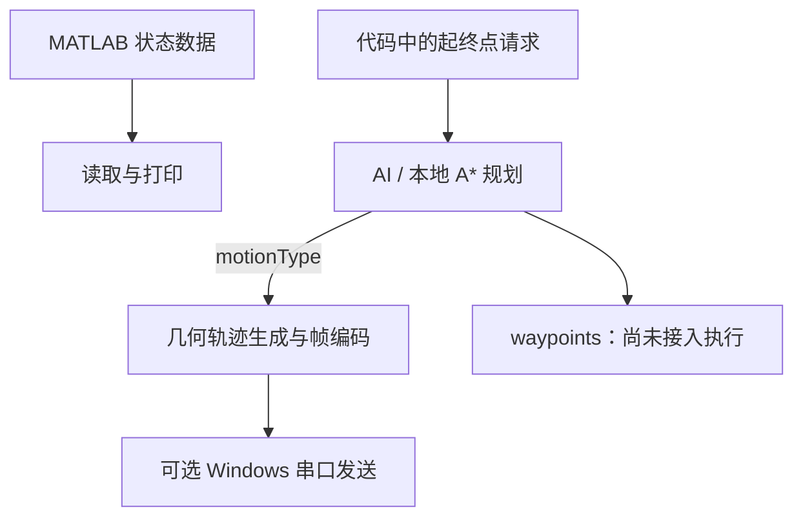

# 51 MCU Motion Simulation

**从运动轨迹到二进制协议帧的 C++ / MATLAB / MCU 工程原型。**

这个项目探索如何将连续轨迹离散成位置与速度状态，在 PC 端生成、编码，并通过串口交给 MCU 做 LED 点阵运动演示。它连接了轨迹数学、软件模块、通信协议和嵌入式接口，适合研究这些环节之间的数据契约与验证方法。

当前可复现的入口是 **PC 离线运动生成与协议编码**。固件、串口和 AI 规划模块已存在，完整硬件链路仍需分阶段验收。

**下一阶段方向：用中文控制 MCU。** 用户输入运动描述，AI 转成受限计划，经程序检查和预览确认后，在现有 8×8 LED 点阵上演示。该功能目前处于[实施提案评审](docs/natural-language-control-v0.1.md)，尚未实现；本次不接入机器人。

[快速运行](#快速运行) · [实际数据流](#实际数据流) · [协议接口](#协议接口) · [验证与下一步](#验证与下一步)

## 项目能做什么

| 模块 | 已有能力 | 工程状态 |
|---|---|---|
| 轨迹生成 | 直线、正弦、圆弧；状态包含 `x, y, vx, vy` | 有实现及现有运动测试 |
| 路径规划 | DeepSeek 请求入口、本地 A* 降级 | 主程序使用返回的运动类型；路径点尚未进入执行链路 |
| 协议编码 | 10 字节帧、坐标/速度量化、XOR 校验 | 编码侧已有单元测试 |
| PC 串口 | Windows 串口发送与 ACK 等待 | 有实现；真实串口往返待验证；Linux 为占位实现 |
| MCU | 接收状态机、帧解码、队列、LED 与 HAL 模块 | 固件编译、烧录及硬件演示待验证 |
| MATLAB | 轨迹可视化、状态向量生成、示例数据 | 主程序目前读取并打印数据 |

## 快速运行

PC 离线模式不需要开发板、MATLAB 运行时或 AI API 密钥。需要 **CMake 3.16+** 与支持 **C++20** 的编译器。在仓库根目录执行：

### Linux / GCC 或 Clang

```sh
cmake -S . -B build/Debug -DCMAKE_BUILD_TYPE=Debug
cmake --build build/Debug
ctest --test-dir build/Debug --output-on-failure
cd build/Debug
env -u DEEPSEEK_API_KEY -u MCU_SERIAL_PORT ./TrajectorySystem
```

### Windows / Visual Studio 生成器

```powershell
cmake -S . -B build
cmake --build build --config Release
ctest --test-dir build -C Release --output-on-failure
Remove-Item Env:DEEPSEEK_API_KEY, Env:MCU_SERIAL_PORT -ErrorAction SilentlyContinue
Set-Location build
.\Release\TrajectorySystem.exe
```

编译器应先在当前终端可用；使用 MSVC 时可打开 Visual Studio Developer PowerShell。MinGW 是单配置生成器，程序一般位于构建目录根部。

CMake 会复制仓库内的 `matlab/trajectory.txt` 到构建目录。主程序从该目录运行，结束时按回车；Windows 还保留了 `pause` 提示。此前离线示例生成 **58 个轨迹点、58 帧、580 字节**，具体结果取决于代码中的请求与运动类型。

## 实际数据流



两个尚未闭合的接口决定了后续工作的重点：

- MATLAB 文件被读取到 `trajectory0` 并打印，目前不参与路径请求或执行轨迹的构造。
- 规划返回的 `plan.waypoints` 尚未传给轨迹生成器；当前生成器根据原起终点和 `motionType` 重新生成轨迹。因此不能从“A* 调用成功”推断最终轨迹遵循其避障路径。

接口职责和模块限制详见 [PROJECT.md](PROJECT.md)。

## 协议接口

编码入口为 [`encodeFrames`](src/protocol.cpp)。每个轨迹点对应一帧：

| 字节偏移 | 内容 |
|---|---|
| `0` | 帧头 `0xAA` |
| `1` | 运动类型 |
| `2–3`、`4–5` | X、Y 的 16 位量化值，高字节在前 |
| `6–7` | 有符号 8 位量化速度 Vx、Vy |
| `8` | 保留位，当前为 `0x00` |
| `9` | 前 9 字节的 XOR 校验 |

量化范围由当前轨迹计算；帧本身不携带原坐标范围和速度缩放比例。MCU 端若要恢复物理量，需要另行约定这些尺度。PC 编码与固件解码的互操作仍需联合测试。

## 工程导航

| 入口 | 内容 |
|---|---|
| [src/](src/) | PC 入口、运动生成、规划、编码与串口 |
| [firmware/](firmware/) | MCU 协议、队列、LED 与硬件抽象层 |
| [matlab/](matlab/) | 可视化脚本及预计算轨迹数据 |
| [tests/](tests/) | 运动/协议测试与串口 MCU 模拟器 |
| [CMakeLists.txt](CMakeLists.txt) | PC 程序和测试的构建入口 |
| [PROJECT.md](PROJECT.md) | 架构、真实数据流、待确认的接口职责 |
| [构建验证记录](docs/build-verification-20261103.md) | 复现命令、离线结果与断言负对照 |
| [清理记录](docs/repository-cleanup-20261103.md) | 资产保留、缓存清单及回滚方法 |

## 验证与下一步

2026-11-03 的本地验证：Linux GCC Debug / Release 均完成全量构建，两种配置的 CTest 均 **2/2 通过**，离线主程序均退出 0。Release 的故意错误断言会触发失败，确认测试断言没有被 `NDEBUG` 移除。以上结果只覆盖报告中实际运行的路径。

远程结果以 [GitHub Actions](https://github.com/12313Q2312/51-MCU-Machine-Operation-Simulation/actions) 的具体提交为准；清理分支与构建修复分支包含的代码不同，不能互相代替验证。MATLAB 执行、真实串口、固件烧录及 LED 硬件演示尚未验收。

后续优先级：

1. 评审[自然语言控制 v0.1 提案](docs/natural-language-control-v0.1.md)，确定计划契约、JSON 依赖及第一版执行范围。
2. 实现并验证离线计划、轨迹编译与预览，再接入真实 AI；无效指令不产生串口输出。
3. 完成固定工作区编码与逐帧执行，在模拟器和真实硬件上分别验收。

维护采用独立分支、Git 提交、测试证据和人工审核。项目负责人确定方向与最终合并，AI 工程助手承担实现、排查和文档维护；具体规则见 [维护约定](docs/maintenance.md)。
