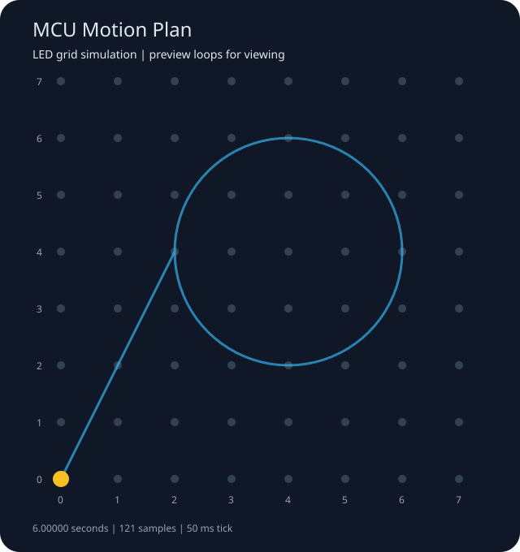

# Text-to-MCU Motion Control

**用一句中文描述运动，让 AI 生成计划，在 51 单片机的 LED 点阵上演示。**

例如：“从左下角走到 (2,4)，用两秒；再以 (4,4) 为圆心、半径两格，顺时针画一圈，用四秒。”

项目把文字理解、结构化动作、轨迹数学、协议编码和嵌入式执行连成一个可检查的过程。用户先看到动作列表和动画预览，再选择连接单片机执行。第一版执行对象是 **8×8 LED 点阵上的光点**，支持直线、整圆、等待和有限次数的重复。

当前交付为 v0.1 软件原型。离线演示可直接运行，在线 AI 和开发板联调待验收。源码、测试和演示均可在本仓库查看。

**快速体验。** 下载 [网页模拟器](web-sim/index.html) 后用浏览器打开，可观察 8×8 点阵、10 字节帧和 ACK。网页模拟器使用内置样例。[旧版轨迹示例与调试指南](使用说明.md)

上图来自离线固定样例。下载 SVG 后用浏览器打开可看动画；蓝线是连续轨迹，黄色光点按 LED 格点跳动。预览循环播放便于观察，实际执行按计划的 repeat 次数结束。

[运行演示](#运行演示) · [在线输入中文](#在线输入中文) · [连接单片机](#连接单片机) · [验证状态](#验证状态) · [操作指南](docs/user-guide.md)

## 工作方式

1. AI 将中文描述转换成受限的 JSON 动作计划；不明确或不支持的指令返回补充问题。
2. 本地 C++ 程序严格检查字段、工作区、时长、动作数量、圆周和重复连续性。
3. 本地编译器按 50ms 节拍生成确定的轨迹，不让模型逐点编造串口数据。
4. 生成动作说明、CSV 轨迹、SVG 动画及运行记录。
5. 用户明确选择执行后，才打开指定串口，逐帧发送并检查 ACK；超时、取消或异常停止后续发送。

AI 调用失败不会自动变成 fakeAI 或其他运动。两轴使用 [0,7] 格坐标，左下角为 (0,0)，不是毫米。多动作共用固定尺度，不将每一段拉伸到整个点阵。

## 运行演示

PC 端需要 **CMake 3.16+、C++20 编译器**；启用测试时还需要 Python 3，测试仅用标准库。nlohmann/json 已固定版本附带在源码中，构建时不下载。离线演示无需 API 密钥、开发板或 MATLAB。

### Windows / Visual Studio

在 Visual Studio Developer PowerShell 中，从仓库根目录运行：

~~~powershell
cmake -S . -B build
cmake --build build --config Release
ctest --test-dir build -C Release --output-on-failure
.\build\Release\MotionControl.exe --demo --simulate --output artifacts\demo
~~~

### Linux / GCC 或 Clang

~~~sh
cmake -S . -B build -DCMAKE_BUILD_TYPE=Release
cmake --build build -j 4
ctest --test-dir build --output-on-failure
./build/MotionControl --demo --simulate --output artifacts/demo
~~~

浏览器打开输出目录中的 **preview.svg** 查看动画。该演示应生成 **121 个点、121 帧、1210 字节，计划用时 6 秒**。--simulate 用真实固件解码函数和虚拟时钟完成协议模拟，不代表已经连接开发板，也没有调用 AI。

输出目录必须尚不存在；再次运行时更换 --output，避免覆盖上一次记录。输出包括 plan.json、trajectory.csv、preview.svg 和 run.json，后者标明来源、执行方式、发送及 ACK 数量。

## 在线输入中文

第一版在线适配器使用 Windows WinHTTP，默认模型 deepseek-flash，可通过 --model 指定。接口依据 [DeepSeek JSON Output](https://api-docs.deepseek.com/guides/json_mode/) 与 [Chat Completions](https://api-docs.deepseek.com/api/create-chat-completion/) 文档实现；真实在线调用尚需独立验收。

在本机设置 DEEPSEEK_API_KEY 后：

~~~powershell
.\build\Release\MotionControl.exe --text "从左下角走到右上角，用三秒" --output artifacts\ai-preview
~~~

默认只生成预览。无密钥、网络错误、无效响应或越界计划会返回错误，串口不会打开。不要把密钥写进源码、计划文件或 Git 提交。Linux 当前支持离线计划与模拟执行，在线 AI 和真实串口入口限定 Windows。

## 连接单片机

先阅读[开发板联调说明](docs/user-guide.md#开发板联调)，确认板型、接线、固件与复位状态，再选择执行：

~~~powershell
.\build\Release\MotionControl.exe --text "画一个圆" --execute --port COM3 --output artifacts\board-run
~~~

程序先展示完整计划；输入 EXECUTE 才打开端口。新入口不依据 MCU_SERIAL_PORT 自动执行。Ctrl+C 停止后续发送，LED 可能保持最后一点；当前协议没有远程硬件急停命令。

10 字节帧布局沿用原协议：AA、运动类型、X/Y 大端 16 位坐标、Vx/Vy、保留位、XOR。本模式位置固定量化，速度字段为零，逐帧发送等待 ACK。ACK 是固件处理确认，不是物理位置反馈。

## 验证状态

| 能力 | 当前证据与范围 |
|---|---|
| 计划解析与轨迹编译 | 离线测试覆盖正常动作、整圆、重复、非法字段/范围/时长/JSON |
| 预览与 CLI | 固定样例、提供方响应样例、中文路径、输出文件及取消行为有集成测试 |
| PC/固件协议互操作 | C++ 帧交给 firmware/protocol.c 解码，LED 驱动全部 64 个格点经主机测试 |
| 执行异常 | 模拟设备覆盖节拍、ACK 回绕/超时/错序、部分写入、取消和异常后的停止 |
| 在线 AI | Windows 适配器已实现；本轮未调用真实 API，离线样例不证明在线理解准确率 |
| 开发板 | 串口执行接口已实现；目标固件编译、烧录、真实串口及 LED 演示待联调 |

v0.1 的远程验收中，Windows/MSVC、Linux/GCC 和 Linux/Clang 均通过构建和测试。测试页面底部的 Artifacts 提供各平台可执行文件和离线演示。第一次体验可下载对应平台产物，打开其中的 preview.svg，或用下方命令重新生成。[三平台验收与下载](https://github.com/12313Q2312/51-MCU-Machine-Operation-Simulation/actions/runs/41756211229)

~~~powershell
.\MotionControl.exe --demo --simulate --output demo-local
~~~

Windows 命令在可执行文件所在目录运行。Linux 使用 ./MotionControl，参数相同。详细测试覆盖见[实现验证记录](docs/control-verification-20261103.md)。

## 工程导航

| 入口 | 用途 |
|---|---|
| [src/control/](src/control/) | 新 MotionControl：AI、计划、轨迹、预览与执行器 |
| [firmware/](firmware/) | MCU 解码、LED、队列与 HAL；主机验证复用实际 C 源码 |
| [tests/](tests/) | 原有测试、新控制核心与 CLI 验收 |
| [计划样例](docs/natural-language-plan.example.json) | 不调用 AI 的确定性输入 |
| [v0.1 方案与契约](docs/natural-language-control-v0.1.md) | 产品目标、接口、边界与分阶段验收 |
| [PROJECT.md](PROJECT.md) | 新旧链路与工程状态 |
| [维护约定](docs/maintenance.md) | 分工、授权、Git 与合并规则 |
| [第三方依赖清单](third_party/nlohmann/manifest.json) | 版本、来源、许可证与完整性摘要 |

原 TrajectorySystem 示例保留，用于查看 MATLAB 数据、旧 AI/A*、几何生成与自动量化方式。其起终点写在代码中，waypoints 尚未接入最终执行，且设置 MCU_SERIAL_PORT 会尝试发送；不要把它作为新模式入口。MATLAB 定位为独立轨迹分析与对照工具。

项目负责人负责目标、方案和验收，AI 工程助手负责实现、测试及文档。变更保持可恢复提交和 Draft PR，最终合并由负责人批准。
